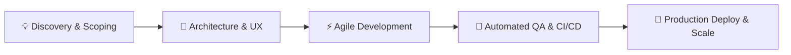

<!-- HERO HEADER -->
# 👋 We are Dev-Sox
### **Architecting Scalable Digital Products & Rapid MVPs**

  

> *Transforming ambitious ideas into market-ready products with modern engineering, cloud-native scalability, and rapid execution.*

---

### 🚀 About Us

**Dev-Sox** — это технологическая компания и студия заказной разработки полного цикла. Мы помогаем стартапам и бизнесу запускать надёжные **MVP за считанные недели**, масштабировать существующие платформы и внедрять современные практики DevOps & Cloud.

* ⚡ **Speed to Market:** Запуск первых версий продуктов от идеи до продакшена в сжатые сроки.
* 🛡️ **Clean Architecture & Quality:** Чистая кодовая база, безопасность, тестирование и строгий code review.
* ☁️ **Cloud Native:** Готовность к высоким нагрузкам благодаря отказоустойчивой инфраструктуре в AWS / GCP.

---

### 🛠️ Core Services

<table>
  <tr>
    <td width="50%">
      <h3>📱 Mobile & Web Engineering</h3>
      <ul>
        <li>Кроссплатформенные приложения на <b>Flutter</b> и <b>React Native</b></li>
        <li>Современные web-платформы на <b>React</b>, <b>Next.js</b> и <b>Angular</b></li>
        <li>Отзывчивый UI/UX с фокусом на конверсию и производительность</li>
      </ul>
    </td>
    <td width="50%">
      <h3>⚙️ Backend & API Systems</h3>
      <ul>
        <li>Микросервисы и REST/GraphQL API на <b>NestJS / Node.js</b> и <b>Spring Boot</b></li>
        <li>Высоконагруженные базы данных (PostgreSQL, MongoDB, Redis)</li>
        <li>Интеграции платежей, авторизации и сторонних сервисов</li>
      </ul>
    </td>
  </tr>
  <tr>
    <td width="50%">
      <h3>☁️ DevOps & Infrastructure</h3>
      <ul>
        <li>Автоматизированные CI/CD пайплайны (GitHub Actions, GitLab CI)</li>
        <li>Контейнеризация и оркестрация (Docker, Kubernetes)</li>
        <li>Инфраструктура как код (Terraform, CloudFormation) на AWS и GCP</li>
      </ul>
    </td>
    <td width="50%">
      <h3>🔍 Audit, Consulting & MVPs</h3>
      <ul>
        <li>Технический аудит и рефакторинг legacy-систем</li>
        <li>Консалтинг по архитектуре и масштабированию</li>
        <li>Валидация гипотез и быстрый запуск Minimum Viable Product</li>
      </ul>
    </td>
  </tr>
</table>

---

### 🧰 Tech Stack

#### Frontend & Mobile

#### Backend & Databases

#### Cloud & DevOps

---

### 📊 Dev-Sox GitHub Analytics

  
  

---

### 🤝 How We Work

1. **Discovery & Architecture:** Определяем цели бизнеса, ключевые метрики и проектируем масштабируемую архитектуру.
2. **Sprint-driven Development:** Двухнедельные спринты с постоянными демо и прозрачным бэклогом.
3. **Automated Testing & Delivery:** Непрерывная интеграция и автоматическое развертывание в изолированные окружения (Dev / Staging / Prod).
4. **Maintenance & Growth:** Пост-релизная поддержка, оптимизация под нагрузки и безопасность.

---

### 📬 Get In Touch

Готовы запустить свой следующий проект или усилить команду разработки?

* 🌐 **Website:** [devsox.com](https://devsox.com)
* 💼 **Partnerships & Projects:** [team@devsox.com](mailto:team@devsox.com)
* 🤝 **Careers:** Присоединяйтесь к нашей распределённой инженерной команде! Пишите на [careers@devsox.com](mailto:careers@devsox.com)

  

